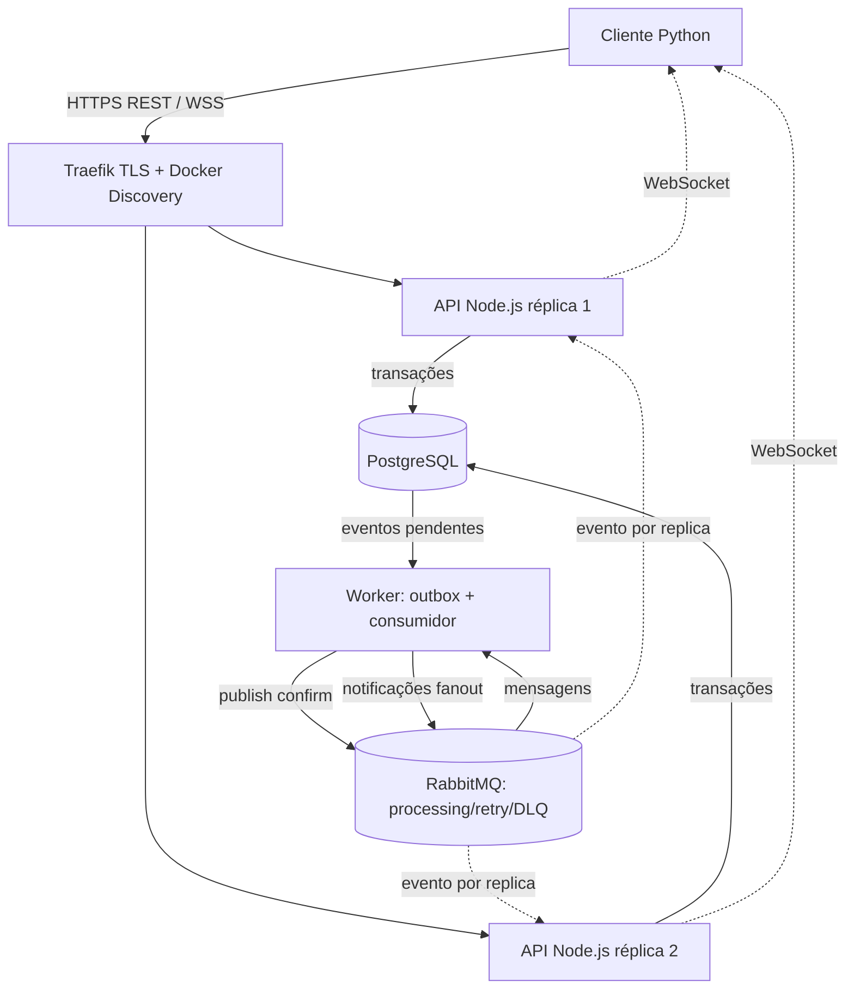

# Arquitetura, resiliência e decisões

## Mapa de comunicação

## Quem resolve nomes / rotas

O Traefik observa serviços Docker etiquetados e oferece HTTPS no gateway `localhost:8443`. Regras de path: `/api/*`, `/health/*` e `/ws`. Resolve dinamicamente as duas réplicas do serviço `api` e redistribui a carga; o algoritmo é o balanceamento padrão do Traefik (round-robin ponderado), sem promessa de escalonamento automático. A API usa nomes `postgres` e `rabbitmq` pelo DNS interno do Docker. Nenhum IP privado é codificado.

A configuração de Compose suporta escala **manual** `--scale api=2`; não oferece HPA/ASG, e o gateway e banco continuam sendo pontos únicos de falha. Não anunciar alta disponibilidade de ponta a ponta.

## Fluxo síncrono e assíncrono

1. Python chama REST e recebe resposta JSON conforme OpenAPI.
2. API abre transação PostgreSQL, bloqueia a linha da fila, registra senha e evento na mesma transação.
3. Worker lê evento pendente em PostgreSQL usando `FOR UPDATE SKIP LOCKED`, publica persistentemente no RabbitMQ e espera confirmação; somente então registra `publicado_em` e confirma no banco.
4. Consumidor processa mensagem, grava `eventos_processados` e publica um evento de notificação para exchange fanout.
5. Cada API assina uma fila exclusiva da exchange de notificações e avisa clientes WebSocket autorizados do mesmo posto.
6. Evento WebSocket apenas sinaliza que a fila mudou; o cliente atualiza a tela/terminal pelo endpoint REST, usando o banco como verdade.

## Consistência e falhas

- **Consistência forte de senhas:** a transação serializa emissão/chamada de uma mesma fila nas duas réplicas.
- **Consistência eventual das notificações:** atrasos ou falhas no RabbitMQ não alteram a verdade persistida. WebSocket não garante replay de eventos para cliente desconectado; consulta REST corrige o estado.
- **Outbox:** não perde evento confirmado se o RabbitMQ cair entre a transação da senha e o envio ao broker. Uma falha depois de publicar e antes do commit pode republicar; evento `id` único garante deduplicação de processamento durável.
- **Retries e DLQ:** falhas de processamento seguem para fila retry, TTL 3 segundos, máximo 3 tentativas, depois DLQ. Uma indisponibilidade extensa de banco pode levar mensagens à DLQ e exigir replay manual.
- **Circuit Breaker:** após três falhas de relay/publicação no Worker, interrompe tentativas por 6 segundos, realiza tentativa HALF_OPEN, depois volta a CLOSED se bem-sucedida.
- **Falha de uma API:** Traefik deve retirar nó não saudável e encaminhar ao outro; conexões WSS ligadas ao nó parado caem e cliente reconecta.
- **Falha do PostgreSQL ou Traefik:** não existe segundo nó desses componentes; respostas devem retornar falha controlada e logs. Não alegar recuperação automática por redundância.

## Segurança

- Client HTTPS/WSS via Traefik. **Certificado local de demonstração não é confiável**; a opção Python `--inseguro` desativa validação somente localmente e não pode ser usada em produção.
- JWT HS256 com segredo forte, emissor, audiência e validade de 2h. `CIDADAO` só consulta seu ticket; `ATENDENTE` opera somente o posto autorizado.
- A rota `/auth/atendente` usa credencial de demonstração compartilhada por posto; não é autenticação de pessoas reais nem está pronta para produção. Sem rate limit distribuído, MFA, rotação de chaves ou auditoria regulatória.
- Senhas de bancos/broker e JWT em `.env` não versionado. AWS Secrets Manager opcional armazena JWT_SECRET e STAFF_PASSWORD; a app lê via AWS SDK quando `AWS_SECRET_ID` definido.
- Comunicação API↔DB e API↔Rabbit no segmento privado Docker não usa mTLS neste MVP. Não apresentar como criptografia serviço a serviço.
- Acesso ao socket Docker no Traefik/Dozzle concede privilégios relevantes mesmo com mount `:ro`; use apenas no laboratório local e não publique os painéis.

## Logs

Cada requisição registra método, rota, status, duração, timestamp, instância e `correlation_id`. O mesmo ID é persistido no evento, transmitido na mensagem RabbitMQ e logado no Worker. As duas APIs e Worker registram JSON em stdout. Logs podem ser agregados via `docker compose logs` ou Dozzle (porta 8081 somente localhost).

## Custos e nuvem

O MVP principal é local e não exige recursos AWS. A única integração AWS planejada é o Secrets Manager; Terraform cria somente o recurso, e o valor é gravado fora do state Terraform. Qualquer `terraform apply` poderá gerar cobrança e requer decisão do grupo, credenciais autorizadas e limpeza pós-apresentação. Não existe VPC/RDS/ALB/ASG neste MVP.
