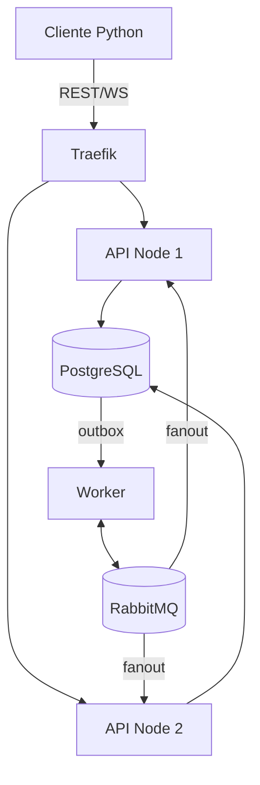

# Arquitetura-alvo — SAC Bahia MVP

## Contexto (processos autônomos)
`Python CLI -> HTTPS/WSS -> Traefik -> API Node.js (2 instâncias) -> PostgreSQL`

`API -> transação PostgreSQL [senha + evento/outbox] -> Worker (relay) -> RabbitMQ (confirm publish) -> Worker (consumer) -> exchange de notificações -> consumidores nas duas APIs -> WebSocket -> Python CLI`

O cliente e os serviços se comunicam **por rede**, jamais por memória compartilhada entre nós. O PostgreSQL é a fonte de verdade, o RabbitMQ é o canal assíncrono, e o WebSocket é notificação de melhor esforço.

## Escolhas e trade-offs
- **REST/OpenAPI**: contrato legível, interoperabilidade Python/Node; atende exemplo do professor.
- **WS**: substitui polling HTTP contínuo e entrega avisos em tempo real.
- **RabbitMQ**: um broker para fila durável, DLQ e fanout; evita Redis + SQS + ElasticMQ.
- **PostgreSQL**: transações com `SELECT ... FOR UPDATE`, UNIQUE e pool; SQLite não é adequado como banco compartilhado entre réplicas.
- **Outbox no Worker**: preserva evento após commit mesmo quando broker cai; sem publisher como processo separado.
- **Traefik**: balanceia réplicas descobertas via Docker; **não** implica auto-scaling por CPU. Não alegar HPA.
- **Secrets Manager**: integração separada para evidência C5, não requisito de inicialização local.

## Serviços de nomes e rotas
- Docker DNS resolve `postgres`, `rabbitmq` dentro da rede `backend`.
- Traefik descobre serviço `api` pelos metadados do Docker e recebe na entrada `https://localhost:8443`.
- Rotas `/api/*`, `/health/*` e `/ws` dirigidas a uma réplica saudável; frontend CLI não conhece IP dos nós.
- O algoritmo de balanceamento usado deve ser **verificado na configuração efetiva do Traefik**. Não afirmar algoritmo especial sem evidência.
- Testar scale manual `--scale api=2` e interrupção de uma réplica. Scale manual/discovery não equivale a escalonamento horizontal automático.

## Persistência e consistência
- Transação inclui modificação em `senhas`, incremento de contador quando aplicável e inserção em `eventos`.
- Lock em `filas` serializa operação concorrente por posto; UNIQUE garante defesa adicional.
- Worker publica eventos persistidos com confirmação; registrar `publicado_em` apenas após confirmação positiva. Se publicar e cair antes de registrar, ocorrerá republicação — deduplicar.
- Consumidor registra `eventos_processados` para proteger efeitos duráveis. **Não presumir exactly-once da rede**.
- RabbitMQ pode cair: emissão deve permanecer confirmada no PostgreSQL; aviso WS fica atrasado e será reconciliado.

## Superfície de segurança
- Token JWT assinado e com expiração; papel CIDADAO só consulta ticket correspondente; ATENDENTE só opera posto autorizado.
- HTTPS/WSS local com certificado de desenvolvimento; `--inseguro` apenas localhost; credenciais nunca em logs.
- `.env` não pode ser enviado ao Git. AWS IAM de leitura apenas do segredo, se integração for feita.
- Portas de banco e AMQP não expostas ao host; console RabbitMQ e Dozzle somente loopback.
- Prova de controle: acesso sem token, token de outro posto, payload malformado e segredos ausentes.

## Resiliência
- API com 2 réplicas: uma instância pode falhar e tráfego novo ir à outra; conexões WS na instância caída se desconectam e cliente deve reconectar.
- Worker ou RabbitMQ indisponível: eventos permanecem pendentes; não perder estado.
- PostgreSQL e Traefik permanecem pontos únicos de falha no MVP: emitir erro finito/indisponibilidade controlada; não alegar HA geral.
- **Circuit Breaker:** o barema usa como exemplo explícito para excelência C3. Verificar se há circuito funcional no código; se ausente, registrar pendência e só implementar se for escolhido para demonstrar C3 excelente. Não confundir `try/catch` ou retry com Circuit Breaker.

## Telemetria
- Logs JSON com `timestamp`, `level`, `service` e `correlation_id` para API/Worker.
- `X-Correlation-ID` recebe UUID válido ou gera novo; propagar no payload de `eventos` e nos logs.
- Para Tracing Audit, enviar requisição com ID e rastrear no serviço receptor, outbox e Worker; payload inválido pode falhar antes de criar evento: escolher também caso válido para demonstrar múltiplos nós.

## Diagrama sintético

